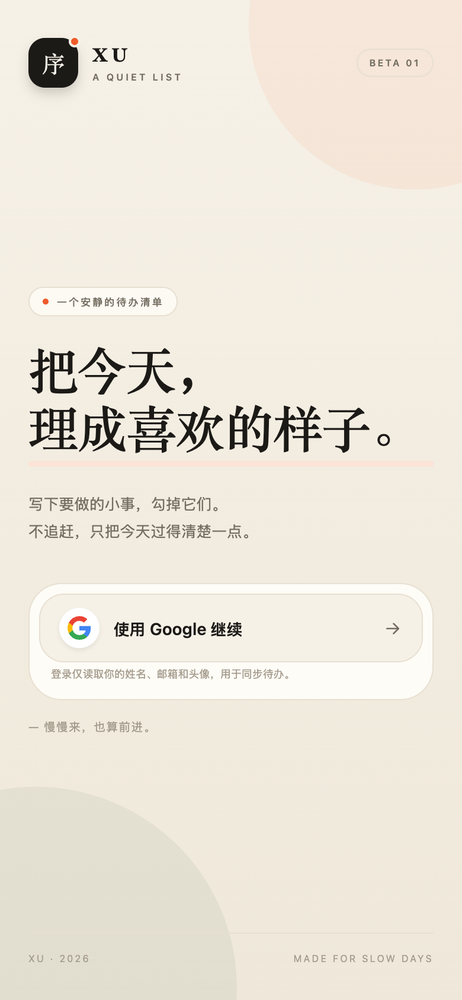
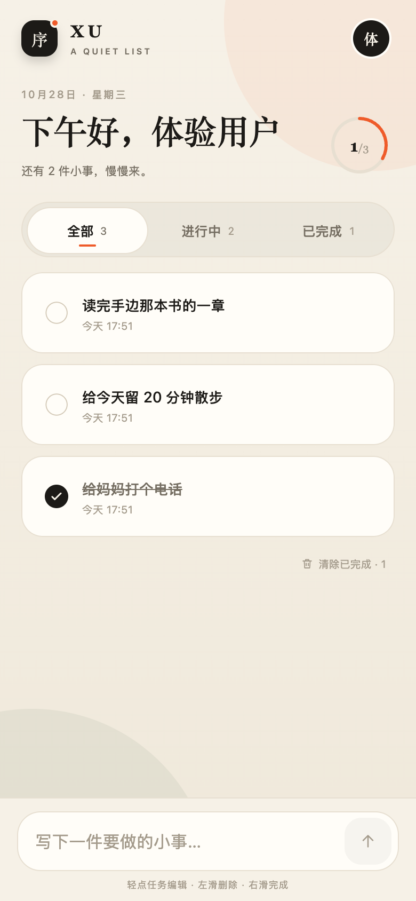
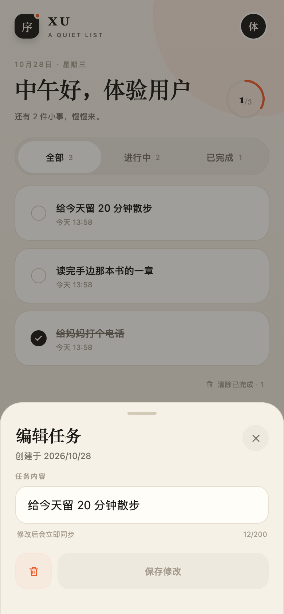
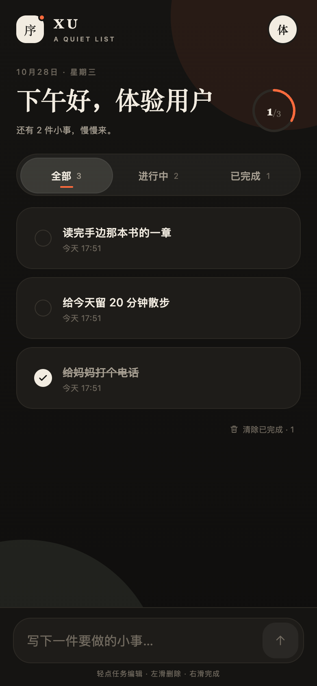
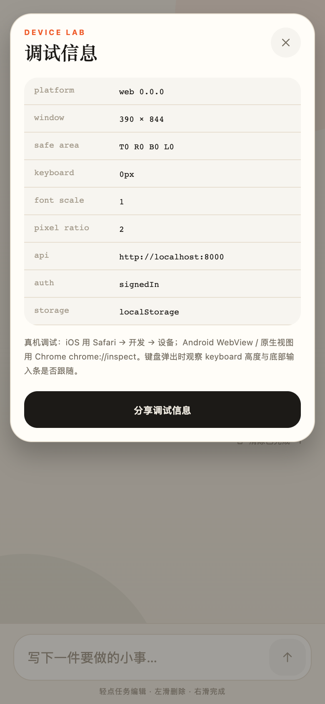

# 序 / XU

用 **React Native + Expo** 写的手机端 Todo App：邮箱验证码登录、任务清单、筛选、进度、乐观更新，以及一个轻量 FastAPI + SQLite 后端。

- 前端代码全部在 **`src/`**，使用现有 Expo SDK 58 / React Native 0.88 工程
- 没有 `apps/web`；此前那版 Web 原型已移除
- 后端移到根目录 **`server/`**

> 截图来自 Expo Web 预览（同一套 React Native 组件）；iOS / Android 使用原生渲染与原生安全区、键盘行为。
>
> 登录页截图是加入邮箱登录之前的版本，当前登录页只保留邮箱验证码入口。




| 编辑任务 | 深色模式 | 调试信息 |
| --- | --- | --- |
|  |  |  |

## 技术栈

| 层 | 选型 |
| --- | --- |
| App | Expo SDK 58、React Native 0.88、React 19、TypeScript、Expo Router |
| 动效 | Reanimated 4、Gesture Handler 3（短时 timing，无弹跳/彩纸） |
| 数据 | TanStack Query 5、expo-secure-store |
| 原生能力 | expo-web-browser、expo-linking、expo-haptics、expo-linear-gradient、react-native-svg |
| 后端 | Python 3.11、FastAPI、SQLite |

## 快速开始

### 1. 启动 API

```bash
cd server
python3.11 -m venv .venv
.venv/bin/pip install -r requirements.txt
cp .env.example .env
.venv/bin/uvicorn app.main:app --host 0.0.0.0 --port 8000
```

`.env.example` 默认开启演示登录。健康检查：<http://localhost:8000/api/health>。

邮箱验证码登录需要在 `server/.env.local` 配置 `MAIL_*`（见下文）。不配置也能本地联调：验证码会打印在 API 日志里。

### 2. 启动 App

```bash
# 仓库根目录
npm install
npx expo start
```

按 `i` 打开 iOS Simulator、`a` 打开 Android Emulator，或用 Expo Go 扫码在真机运行。

手机和电脑在同一 Wi-Fi 时，App 会从 Expo 的 `hostUri` 推导 API 主机（默认端口 8000）。也可以显式覆盖：

```bash
EXPO_PUBLIC_API_URL=http://192.168.2.105:8000 npx expo start
```

> 本机没有安装 Xcode / Android Emulator，因此没有实际启动原生模拟器；已通过 `npx expo export --platform ios` 和 `--platform android` 验证原生 bundle 能完整打包。请用 Expo Go 或 development build 体验。

登录页输入邮箱、收取 6 位验证码即可进入；账号首次登录会自动创建，清单从空白开始。

## Google 登录（后端保留，登录页未展示）

> 登录页现在只提供邮箱验证码。Google OAuth 的后端接口、`AuthProvider` 方法和 `/web-auth` 回跳页仍然保留，需要恢复 Google 入口时可直接重新接入 `LoginScreen`；生产部署也不再强制要求 Google 凭据。

> App 内 Google 登录通过原生 `WebBrowser` 打开系统授权页；Expo Web 预览额外提供了 `/web-auth` 回跳页，也可以在浏览器里完整测试 Google OAuth。生产环境推荐用 iOS / Android 的 development build。

### 代码路径

原生登录走「后端中转 + 一次性 code」，不把 Google token 放进 App：

1. App 用 `WebBrowser.openAuthSessionAsync` 打开后端
   `/api/auth/google/native/start?redirect=nativedemo://auth`
2. 后端生成 state + PKCE，302 到 Google；state 入库并写 HttpOnly cookie
3. Google 回调后端 `/api/auth/google/callback`，后端校验 state、换 token、拉 userinfo
4. 后端生成 5 分钟有效、只存哈希的一次性 login code，302 到 `nativedemo://auth?code=...`
5. App 收到 deep link，调用 `/api/auth/native/exchange` 换 Bearer token，存入 `expo-secure-store`
6. 后续 `/api/todos` 等接口使用 `Authorization: Bearer ...`

### 配置

1. Google Cloud Console 创建 **OAuth 2.0 Client ID → Web application**。
2. 添加 Authorized redirect URI：

   ```text
   http://localhost:8000/api/auth/google/callback
   ```

3. `server/.env`：

   ```dotenv
   PUBLIC_BASE_URL=http://localhost:8000
   GOOGLE_CLIENT_ID=...
   GOOGLE_CLIENT_SECRET=...
   NATIVE_REDIRECT_URIS=nativedemo://auth
   WEB_REDIRECT_URIS=http://localhost:8081/web-auth
   # Expo Go 联调时可开启；正式包建议关闭并改用 development build
   ALLOW_EXPO_GO_REDIRECTS=true
   ALLOW_DEMO_AUTH=true
   ```

4. 重启 API。`GET /api/auth/config` 的 `data.google` 应为 `true`；登录页目前不展示 Google 按钮，接口保留供以后恢复。

Expo Go 联调：

- 后端 `.env` 设置 `ALLOW_EXPO_GO_REDIRECTS=true`，否则 Expo Go 的 `exp://...` 回调会被拒绝
- 手机和电脑必须在同一局域网，Metro 的 `exp://` 地址要能被手机访问
- Google 登录完成后如果浏览器关闭但 App 没收到回调，说明 Expo Go 的自定义 scheme 限制，改用 development build

真实手机上的 Google 登录还需要：

- 后端使用 **HTTPS**（Google 只接受 localhost 的 HTTP 回调）；可用 cloudflared / ngrok，把 `PUBLIC_BASE_URL` 改成隧道地址，并把对应 callback 加到 Google Console
- App 设置 `EXPO_PUBLIC_API_URL=https://你的隧道地址`
- 正式包用 **development build**（`npx expo run:ios` / `run:android` 或 EAS），确保 `nativedemo://auth` 自定义 scheme 能稳定返回 App
- 如果后端只在局域网 HTTP 下运行，Google 登录会失败；此时用邮箱验证码登录

## 邮箱验证码登录

项目的默认登录方式：输入邮箱 → 收 6 位验证码 → 换 Bearer token（与历史 Google 账号共用 session 和账号）。

### 配置 Brevo（免费 300 封/天）

1. 注册 [Brevo](https://www.brevo.com/)，在 **Transactional email → SMTP & API → SMTP keys** 生成 SMTP key。
2. 在 **Senders & IPs** 验证发件邮箱（推荐验证你自己的域名，并配好 SPF/DKIM/DMARC，否则容易进垃圾箱）。
3. 写入 `server/.env.local`（`MAIL_HOST` 填了才算启用）：

   ```dotenv
   MAIL_HOST=smtp-relay.brevo.com
   MAIL_PORT=587
   MAIL_USERNAME=你的 Brevo 登录邮箱
   MAIL_PASSWORD=SMTP key
   MAIL_FROM=已验证的发件邮箱
   MAIL_FROM_NAME=序
   ```

4. 重启 API。`GET /api/auth/config` 的 `data.email` 变为 `true`，登录页出现邮箱输入框。

本地开发不配置 `MAIL_*` 也能走完整流程：`APP_ENV=development` 时验证码会以 `[mail] dev mode, login code for ...` 打到 API 日志，登录页也会提示。

### 安全与限流

- 验证码 6 位数字，只存 SHA-256（`邮箱:验证码`）；10 分钟过期、单次使用、最多 5 次尝试
- 同邮箱 60 秒冷却、每小时 5 次；同 IP 每小时 20 次
- 生产环境未配置 SMTP 时 `/api/auth/email/code` 返回 503，登录页不展示邮箱表单
- 邮箱账号与同邮箱的 Google 账号会自动合并

## 功能

- 邮箱验证码登录 / 退出登录 / 重启后恢复会话（Google OAuth 后端保留，登录页未展示）
- 添加、编辑、完成；左滑展开「完成 / 撤销、删除」操作，当前行变灰，点击才执行；同时只允许一行展开；撤销删除、清除已完成
- 全部 / 进行中 / 已完成筛选，支持点击和左右滑动切换；切换时自动收起已展开的操作；实时计数、完成进度
- 乐观更新与失败回滚
- 加载骨架、空清单、筛选空态、错误重试
- 系统 / 浅色 / 深色主题切换，选择持久化（账号面板）
- 添加任务后自动收起键盘并取消输入框焦点
- 账号面板 + 原生调试面板

## 动效

按「克制」原则实现：

- 登录内容 180–280ms 淡入，不做大幅位移
- 勾选：160ms 缩放与对勾，无弹簧回弹
- 筛选滑块：220ms ease-out
- 进度环：480ms ease-out
- 左滑：跟手展开操作区，宽度随滑动距离变化；两个按钮固定宽度，文字 16px、正常字重、居中，不缩放不位移；todo 文案保持原布局，超出部分裁剪，不重排；当前行背景转灰 `#ECE7DE`（深色 `#2A2724`）；展开时 todo 右侧圆角收平并与操作区合并；右滑收起
- 底部面板：260ms 平滑上移；仅把手区域可拖拽关闭
- Toast：180ms 淡入 / 140ms 淡出

没有彩纸、全屏弹跳或旋转表演。触感反馈只用于勾选、完成、删除等关键操作。

## 移动端细节

- `SafeAreaProvider` + `useSafeAreaInsets` 处理刘海和底部 Home Indicator
- `KeyboardAvoidingView`；输入条在普通布局流中，键盘弹出时整体上移
- TextInput 16px，避免 iOS 聚焦时自动缩放
- 底部面板支持键盘避让与内容滚动
- 触控目标 44px 左右

### 调试

账号面板 → 「调试信息」可查看：

- 平台与版本、窗口尺寸、safe area、键盘高度
- API 地址、当前登录状态
- 字体缩放、像素密度

真机调试：

- iOS：Safari → 开发 → 选择设备 → 选择 App / WebView
- Android：Chrome 打开 `chrome://inspect`
- WebView 需宿主开启 `WebView.setWebContentsDebuggingEnabled(true)`

## 后端设计

### 数据模型

- `users(id, google_sub UNIQUE, email, name, picture_url, is_demo, ...)`
- `sessions(id, user_id FK, token_hash UNIQUE, expires_at)`
- `todos(id, user_id FK, title, completed, position, created_at, updated_at)`
- `oauth_states(state_hash PK, code_verifier, mode, native_redirect, expires_at)`
- `login_codes(code_hash PK, user_id FK, expires_at, used_at)`

索引：

- `todos(user_id, completed, position)`
- `todos(user_id, created_at DESC)`
- `sessions(token_hash)`、`sessions(expires_at)`
- `login_codes(expires_at)`、`oauth_states(expires_at)`

SQLite 开启 WAL / foreign_keys / busy_timeout；写操作使用 `BEGIN IMMEDIATE` 显式事务。移动端 token 只存 SHA-256 hash，API 支持 Bearer 或 Cookie。

### API

JSON 接口统一返回 `{ "code": 200, "data": ..., "message": "success" }`；错误时 `code` 为业务错误码、`data` 为 `null`。`204 No Content` 和 OAuth 重定向不包裹响应体。

| 方法 | 路径 | 说明 |
| --- | --- | --- |
| GET | `/api/health` | 健康检查 |
| GET | `/api/auth/config` | Google / 邮箱 / demo 是否可用 |
| GET | `/api/auth/google/native/start` | 原生 OAuth 起点 |
| GET | `/api/auth/google/web/start` | Web 预览 OAuth 起点 |
| GET | `/api/auth/google/callback` | Google 回调 |
| POST | `/api/auth/native/exchange` | 一次性 code 换 token |
| POST | `/api/auth/native/demo` | 演示账号 + token |
| POST | `/api/auth/email/code` | 发送邮箱验证码 |
| POST | `/api/auth/email/verify` | 邮箱验证码换 token |
| GET | `/api/auth/me` | 当前用户 |
| POST | `/api/auth/logout` | 注销当前 session |
| GET / POST | `/api/todos` | 列表 / 创建 |
| PATCH / DELETE | `/api/todos/{id}` | 更新 / 删除 |
| POST | `/api/todos/clear-completed` | 清除已完成 |

## 测试与检查

```bash
# App 纯函数测试（Node test）
npm test

# 类型 / lint
npx tsc --noEmit
npm run lint

# 原生 bundle
npx expo export --platform ios --output-dir /tmp/xu-ios
npx expo export --platform android --output-dir /tmp/xu-android

# 后端
cd server
.venv/bin/pytest   # 31 tests
```

后端覆盖 OAuth state/回调、native/web code 交换、邮箱验证码（冷却/重试/过期/发送失败）、Google 与邮箱账号合并、users 表迁移、演示开关、会话过期、Todo CRUD、用户隔离、参数校验、Origin 校验。App 侧纯函数测试覆盖日期、姓名、相对时间和 Toast 标题截断。

## Docker

```bash
docker compose up --build
# http://localhost:8000
```

单容器只包含 FastAPI；SQLite 数据在 `xu-data` volume。Compose 为了本地演示开启 `ALLOW_DEMO_AUTH=true`。公开部署请关闭演示，并配置 `MAIL_*` 与 HTTPS。

> 这套 compose 只用于本地演示；生产发布走下一节的脚本（镜像在服务器上构建）。

## 部署（生产）

生产架构示例：Cloudflare → 宿主 nginx → Docker 容器。真实主机、Docker 网络和公网健康检查地址通过环境变量传入，不写入仓库。

```bash
cd server
DEPLOY_HOST=203.0.113.10 \
NETWORK=bridge \
PUBLIC_HEALTH=https://api.example.com/api/health \
./deploy.sh
```

脚本流程：本地 `app/` 与构建文件 rsync 到服务器 `/opt/xu-api` → 服务器 `docker build` 打时间戳镜像 → 旧容器改名 `xu-api-prev` → 起新容器 → 轮询 `/api/health` → 成功则删旧容器、按时间戳标签保留最近 3 个镜像（手工标签如 `1.0` 不动）；失败自动把 `xu-api-prev` 换回来。

- `DEPLOY_HOST` 与 `NETWORK` 必填；`PUBLIC_HEALTH` 可选，不配置时跳过公网自检
- 运行时配置（邮箱 SMTP、域名、`APP_ENV`）在服务器 `/opt/xu-api/run.env`（600），脚本只读不写；首次部署会生成模板并退出
- 每次发布前把代码 tar 和 SQLite 快照放到 `/opt/xu-api/backups/`（保留 5 份），快照失败会中止发布
- 发布的是**工作区代码**，包含未提交改动；建议先 commit
- 脚本不碰 nginx / 证书，反向代理与 TLS 需要单独配置
- 手动回滚（将主机名替换为你的服务器）：

```bash
ssh ubuntu@203.0.113.10 'docker rm -f xu-api && docker rename xu-api-prev xu-api && docker start xu-api'
```

## 打包 Android APK（EAS）

项目已关联 EAS：`@frank.cheng/native-demo`（`app.json` 里有 `extra.eas.projectId`）。`eas.json` 两个 profile：

| profile | 产物 | 用途 |
| --- | --- | --- |
| `preview` | `.apk` | 直接装手机 / 模拟器 |
| `production` | `.aab` | Google Play 上架，自动递增 versionCode |

```bash
EAS_NO_VCS=1 eas build -p android --profile preview
eas build:list --platform android   # 查历史构建与产物链接
```

- 本机的 eas-cli 是 x86_64（跑在 Rosetta），调 `/usr/bin/git` 会因 xcrun 缺 x86_64 切片失败，所以用 `EAS_NO_VCS=1` 走无 VCS 上传；换成 arm64 Node 环境后可以去掉这个变量
- API 地址由 `eas.json` 的 `env.EXPO_PUBLIC_API_URL` 注入（`.env.local` 被 gitignore，不会进构建包），换后端域名要重新打包
- 签名用本地 keystore：`credentials/android/keystore.jks` + `credentials.json`，两者都已 gitignore。**keystore 必须单独备份**，丢了就无法再更新已安装的应用/上架
- 免费套餐会排队，Android 构建单次约 10–20 分钟

## 目录

```text
src/
  app/                 Expo Router 路由（index / login / todos）
  api/                 fetch 封装、认证、任务 API
  auth/                AuthProvider：SecureStore、OAuth、会话恢复
  components/          AppScreen、BrandMark、Sheet、Toast、图标、进度环
  features/auth/       登录页
  features/todos/      清单、任务行、输入条、筛选、编辑 sheet、手势
  features/profile/    账号面板
  features/debug/      原生调试面板
  hooks/               主题
  lib/                 API 地址、存储、格式化、QueryClient
  constants/           颜色、字体、间距
server/
  app/                 FastAPI、SQLite、邮箱验证码 / Google OAuth
  tests/               pytest
  deploy.sh            生产发布脚本
  data/                SQLite 数据文件（本地开发）
docs/
  todo-google-login-plan.md
  screenshots/         Expo Web 预览截图
```

## 说明

- 现有 Expo 工程直接改造，`src/app` 为路由根目录。
- 本轮没有接入 Storybook；优先保证可交互原型、登录链路和真实设备上的布局。
- 生产环境建议把 SQLite 换成 MySQL，并加 Redis 会话/限流；当前 schema 按可迁移的独立表与索引设计。
